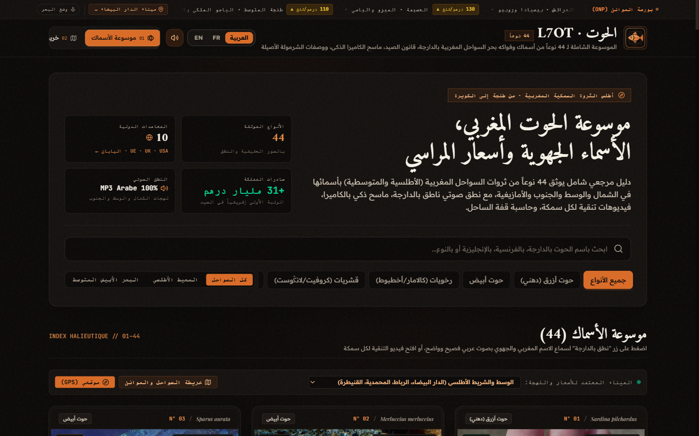
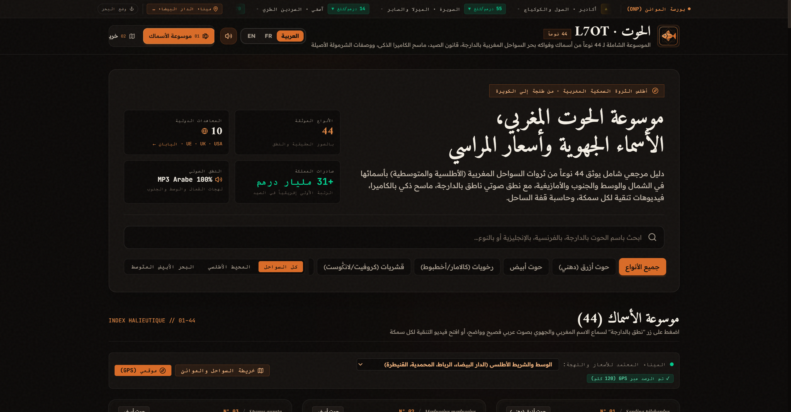
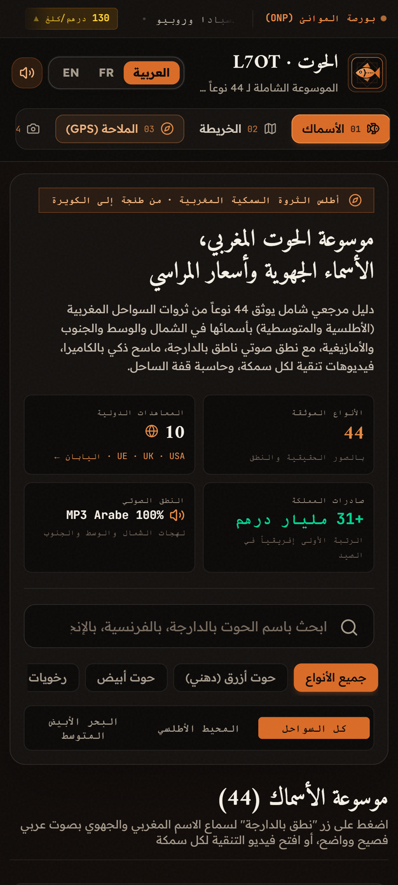
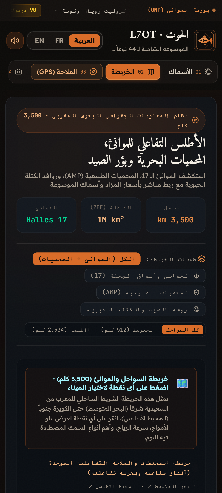

# L7OT (الحوت) — The Moroccan Fish & Marine Encyclopedia

<div align="center">

[](https://github.com/Bosaj/l7ot/actions/workflows/ci.yml)
[](https://github.com/Bosaj/l7ot/actions/workflows/codeql.yml)
[](https://opensource.org/licenses/MIT)
[](https://www.typescriptlang.org/)
[](https://react.dev/)
[](https://tailwindcss.com/)
[](https://www.linkedin.com/in/oussama-el-hadji-388a101b7/)
[](https://github.com/Bosaj/l7ot/releases/tag/v2.1.2)

**The definitive Moroccan seafood encyclopedia, Darija & Oriental dialect taxonomy, port auctions, live marine weather, and coastal culinary heritage.**

[▲ Vercel Production](https://l7ot.vercel.app) • [🚀 Live on Netlify](https://l7ot-morocco.netlify.app) • [🐙 GitHub Pages](https://bosaj.github.io/l7ot/) • [📖 Read the Complete Wiki](https://github.com/Bosaj/l7ot/wiki) • [🐛 Report Issue](https://github.com/Bosaj/l7ot/issues/new/choose)

</div>

---

## 📸 Visual Showcase & Previews

<div align="center">

### 🗺️ Moroccan Coastal GIS Map & Tactical Nautical Layer (3,500 km)


<br/><br/>

### 📱 Responsive Desktop & Universal Mobile Viewport (Pixel, iPhone, Tablets & PC)
<p align="center">
  
  &nbsp;&nbsp;&nbsp;&nbsp;
  
</p>

<p align="center">
  
</p>

</div>

---

## 🌊 Overview

**L7OT (الحوت)** is an open-source, cultural, culinary, and oceanographic platform documenting the rich marine heritage of Morocco across **3,500 km of coastline** spanning both the Atlantic Ocean and the Mediterranean Sea.

From the artisanal ports of **Nador and Saïdia** in the Oriental, to **Tangier Med** on the Strait, **Safi and Casablanca** along the central shelf, and the deep southern waters of **Agadir and Dakhla**, L7OT provides an exhaustive, bilingual reference for seafood lovers, chefs, researchers, and everyday market shoppers.

---

## ✨ Key Features

### 1. 🐟 44 Documented Marine Species & Fruits de Mer
* **Real Photography & Latin Taxonomy:** Every species features high-definition imagery, official binomial nomenclature, biological classification, and nutritional metrics.
* **12 Newly Added Commercial & Artisanal Species:** Mérou brun (*Epinephelus marginatus*), Baudroie (*Lophius piscatorius*), Turbot (*Scophthalmus maximus*), Marbré (*Lithognathus mormyrus*), Sar tambour (*Diplodus cervinus*), Liche amie (*Lichia amia*), Rascasse rouge (*Scorpaena scrofa*), Ombrine côtière (*Umbrina cirrosa*), Homard bleu (*Homarus gammarus*), Dorade grise (*Spondyliosoma cantharus*), Cernier (*Polyprion americanus*), and Grande vive (*Trachinus draco*).
* **Regional Moroccan Dialects (Including Oriental & Amazigh):** Comprehensive nomenclature cataloged across **4 Moroccan coastal regions**:
  * **Oriental & Rif (الجهة الشرقية):** Nador, Saidia, Ras Kebdana, Marchica lagoon (*Titchoukt*, *Pagel*, *Kamber*, *Lubina*, *Choco*, *Akharouy*).
  * **Chamal (الشمال):** Tangier, Tetouan, Larache, Al Hoceima (*Sardina*, *Pez Espada*, *Lubina*, *Chbouk*).
  * **Centre (الوسط):** Casablanca, Rabat, Safi, El Jadida (*Serdine*, *Merla*, *Bouchkache*, *Crevette*).
  * **Sud & Souss (الجنوب وسوس):** Agadir, Tan-Tan, Dakhla, Laâyoune (*Tazenkart*, *Azougar*, *Courbine*).
* **Native Audio Pronunciation:** Built-in speech synthesis pronouncing each fish's name in authentic Moroccan Darija.

### 2. 📍 GPS Coastal Port Geolocation & Local Pricing Engine
* Automatically detects the user's nearest Moroccan coastal port hub using **Haversine great-circle distance**.
* Dynamically adapts the fish catalog to highlight the **local dialect name** and calculates **location-adjusted port auction prices** (reflecting supply dynamics from Nador to Dakhla).

### 3. 🌐 Worldwide Free Marine & Oceanographic APIs Hub
Live interactive telemetry connected to the world’s leading open marine APIs:
1. **Open-Meteo Marine API:** Real-time wave heights, swell directions, wave periods, and artisanal fishing safety indices for 8 Moroccan ports.
2. **WoRMS (World Register of Marine Species):** Authoritative global taxonomy and AphiaID verification.
3. **OBIS (Ocean Biodiversity Information System):** UNESCO-IOC marine occurrence records in Moroccan EEZ waters.
4. **FishBase & SeaLifeBase (rOpenSci):** Trophic levels, ecological vulnerability indices, and biological maturity data.
5. **Open Food Facts:** Open database of packaged and canned Moroccan seafood with Nutri-Score and Eco-Score ratings.
6. **FAO Fisheries Data (ASFIS):** Moroccan catch statistics across international statistical areas FAO 34 & 37.

### 4. 🍽️ 16 Authentic Coastal Recipes & Video Filleting Guides
* Traditional tagines (*Tagine Kouari de Sardine*, *Tagine de Congre aux Raisins Secs*, *Pastilla aux Fruits de Mer*).
* YouTube video demonstrations showcasing traditional Moroccan fish cleaning and filleting techniques (**Le Kessal / الكسال**).

### 5. ⚖️ Chef L7ot Charmoula Calculator
* Interactive spice balance engine calculating exact gram-level proportions of garlic, cumin, paprika, fresh coriander, lemon juice, and olive oil tailored to each fish species and cooking method.

### 6. 📱 AI Camera Fish Scanner
* Mobile-optimized camera scanner enabling users to snap or upload a fish photo at the port or market to instantly detect species, market value, and freshness indicators.

### 7. 🛒 Souk Basket & Species Comparator
* Head-to-head nutritional and economic comparator (Protein, Omega-3, spot price, export value).
* Souk basket budget simulator including *Kessal* cleaning fees and one-click clipboard shopping list export.

### 8. 📈 Continuous Dual-Track ONP Ticker & Zero-Scrollbar UX
* **Dual-Track Infinite Marquee:** Seamless, gapless live telemetry strip covering **12 Moroccan wholesale criées (ONP)** from Nador and Tangier to Agadir and Dakhla.
* **Pause on Hover:** Users can hover anywhere on the telemetry bar to freeze animation and inspect spot prices and trend arrows.
* **Scrollbar-Free Navigation:** Responsive pill clusters with dedicated Lucide iconography that adapt naturally to all screen sizes without awkward horizontal drag or overflow.
* **Deterministic Offline Test Suite:** Fully mocked unit test architecture executing in **7ms** with 26/26 passing tests and 100% green CI automation.

### 9. ⚖️ Moroccan Maritime Law & Spearfishing Compliance Guide (Arrêté 1154-88)
* **Minimum Catch Size Engine:** Interactive catalog of commercial minimum sizes mandated by Dahir 1-73-255 and Arrêté ministériel n° 1154-88 (e.g. Bar ≥ 17 cm, Mérou ≥ 45 cm, Daurade ≥ 19 cm, Poulpe ≥ 500 g).
* **Interactive Dual-Color Fish Ruler:** Visual gauge depicting prohibited sub-size zone vs legal landing threshold.
* **Biological Resting Periods (Repos Biologique):** Scheduled bans for Dusky Grouper (July 1 – August 31) and Common Octopus (bi-annual seasonal recovery).
* **Apnea Spearfishing (Chasse sous-marine) Code:** 6 golden rules under DPM mandate (apnea-only, daylight-only, mandatory Alpha dive buoy, non-commercial catch limit, and license requirements).

### 10. 🎬 Multi-Language Filleting & Preparation Video Guide (100% Species)
* **Dedicated Videos for all 44 Species:** Tailored demonstrations in **Moroccan Darija** (local *kessal* techniques), **French** (haute cuisine filleting), and **English** (master fish butcher preparation).
* **Deep YouTube Search Fallbacks:** Targeted direct queries per species and dialect to prevent generic video repetitions.
* **Click-to-Play Performance:** Zero external tracking scripts or cookies loaded until user interaction.

### 11. 🧭 Interactive Moroccan Coastal Radar (3,500 km Littoral)
* Interactive SVG map spanning **13 major Moroccan ports** across the Mediterranean and Atlantic coasts.
* Real-time oceanographic telemetry (swell height, wind speed, water temp, and top landed species).
* One-click port selection synchronizing active market region, local dialect names, and port auction prices.

### 12. 📅 Moroccan Seasonal Catch & Biological Rest Calendar
* 12-month interactive seafood wheel highlighting peak harvest months vs official ministerial biological rest bans (*repos biologique*).
* Category filters, real-time spot prices, and instant technical card inspection.

### 13. 🐳 Production Containerization & Multi-Cloud Deployment
* **Docker:** Multi-stage `Dockerfile` (`node:22-alpine` + `nginx:alpine`) with gzip, SPA fallback, security headers, and health checks. Launch with `docker compose up -d`.
* **Multi-Cloud Parity:** Pre-configured for **Vercel** (`vercel.json`), **Netlify Edge CDN** (`netlify.toml`, `public/_redirects`), and **GitHub Pages** (`.github/workflows/deploy-pages.yml`).

### 14. 🗺️ Real Interactive Geographic Coastal GIS Map (Leaflet)
* **True 3,500 km Moroccan Coastal Bounds:** Interactive Leaflet GIS covering Saïdia to Lagouira with 17 commercial ports and 4 Marine Protected Areas.
* **Multi-Layer Tile Engine:** Instant toggles for **Esri Oceans** (bathymetric depths & contours), **Esri World Imagery** (high-res satellite), and **National Geographic Physical Terrain**.
* **Moroccan Nautical Lighthouses:** Live tactical overlay with historical flash periods and WGS84 coordinates (Cap Spartel, El Hank, Cap Bojador, Cap de l'Eau).

### 15. ⚓ High-Seas Marine Navigator (Mode Pêcheur en Mer)
* **Nautical Bridge Dashboard:** SVG Gyro Compass dial with magnetic needle pointing to refuge ports, Speed Over Ground (SOG) in Knots, and coordinates in Nautical DMS (`DD°MM'SS" N/W`).
* **Sovereign Maritime Zone Classifier:** Categorizes vessel position according to Dahir 1-73-211 and UNCLOS (Territorial Waters, Contiguous Zone, Moroccan EEZ, International High Seas).
* **VHF Canal 16 & MRCC Emergency Mayday Generator:** Instant 1-click distress message for MRCC Rabat (+212 537 62 58 77) and Gendarmerie Maritime (177).

### 16. 🪙 Bourse Citoyenne (Crowdsourced Souk & Port Price Reporter)
* **Receipt Proof & Community Verification:** Allows citizens and artisanal fishermen across 17 Moroccan markets to report live consumer prices with photo receipts and verification upvotes.
* **National Wholesale Markup Barometer:** Automatically compares crowdsourced spot prices against official ONP criée wholesale baselines to highlight fair pricing vs speculative margins.
* **WhatsApp Share Bulletin:** 1-click export of market price summaries formatted for community WhatsApp groups.

### 17. 🪪 Dynamic Social Specimen Share Cards & Rich SEO
* **HTML5 Canvas Export:** Generates high-resolution 1200x630 social passport cards featuring Moroccan maritime crest, local dialect names, Dahir minimum catch sizes, and spot prices.
* **Google Rich Cards:** Real-time Schema.org `Product` (`SeafoodProduct`) and `Recipe` JSON-LD microdata injection for rich search indexing.

### 18. 🎙️ Neural Studio Voice Pack (132 Recordings in Darija, FR & EN)
* **Native Dialect Speech Synthesis:** 132 high-fidelity neural audio pronunciations for all 44 fish species in authentic Moroccan Darija (`ar-MA`), Parisian French (`fr-FR`), and American English (`en-US`).
* **Soundwave Equalizer:** Dynamic 4-bar audio visualizer with instant fallback to Web Speech Synthesis.

---

## 🗺️ Moroccan Regional Dialect Reference Matrix

| Species | Central Darija | Oriental (Nador/Saïdia) | Chamal (Tangier) | Souss & South (Agadir) |
|---|---|---|---|---|
| **Sardine** | السردين (Serdine) | **تيتشوكْتْ (Titchoukt)** / الخشبة | سردينة (Sardina) | تازنكارت (Tazenkart) |
| **Mérou brun** | الميرو (Mérou) | **الميرو د ريف** / ميرو قارش | ميرو الحجرة | أمود أزوكاغ (Amoud) |
| **Pageot Royal** | الباجو الملكي (Pageot) | **باخيل (Pagel / Bajel)** | باجيل الحجرة | الباجو السوسي |
| **Turbot** | التربو (Turbot) | **التربو د كبدانة** / روضوب | طوربو د البوغاز | التربو الصحراوي |
| **Crevette Rose** | الكروفيت (Crevette) | **كامبار (Kamber)** / الغامبا | الغامبا الشمالية | كروفيت طانطان |
| **Poulpe** | الأخطبوط / الروكبا | **بوكْرون (Boukroun)** / أخروي | أخطبوط المضيق | أخطبوط واد الذهب |
| **Loup / Bar** | بوشوك / الدرعي | **لوبينا (Lubina)** / دراك | لوبينا د كاب سبارطيل | الدرعي السوسي |
| **Rascasse rouge** | البوكشاش (Bouchkache) | **شكريت د مارشيكا** | شبوك (Chbouk) | أبوعكرام (Abouakram) |
| **Calamar** | الكالامار (Calamar) | **شوكو (Choco)** / حبار مارشيكا | كالمار القصر الصغير | كالامار الداخلة |
| **Liche amie** | الليشة (Liche) | **الليشة الريفية** / بالوميطا | ليتشا د البوغاز | تصلافت (Taslaft) |
| **Rouget Barbet** | الروجي (Rouget) | **سالمونيتي (Salmonete)** | روجي الحجرة | الحمرية د سوس |
| **Seiche** | السيبيا (Sepia) | **خيبيا (Jibia)** / نوافة | سيبيا طنجة | زايوط د الداخلة |

---

## 🚀 Quick Start & Local Development

### Prerequisites
* **Node.js:** `v20.x` or `v22.x`
* **npm:** `v10.x+`

### Installation
```bash
# 1. Clone repository
git clone https://github.com/Bosaj/l7ot.git
cd l7ot

# 2. Install dependencies
npm install

# 3. Start development server
npm run dev

# 4. Run tests
npm run test

# 5. Production build
npm run build
```

---

## 🏗️ Architecture & Tech Stack

```
l7ot/
├── src/
│   ├── components/         # UI Components (FishCard, FishModal, MaritimeLawGuide, Header, MarineWeatherAndApis...)
│   ├── data/               # 44 Species Catalog (fish.ts, extraFish.ts), 16 Recipes, International Treaties
│   ├── hooks/              # useUserPortLocation (GPS Haversine engine)
│   ├── i18n/               # Tri-lingual localization strings (AR, FR, EN)
│   ├── lib/                # Speech synthesis, Charmoula calculator, Moroccan Port Regions
│   ├── services/           # Real clients for Open-Meteo, WoRMS, OBIS, FishBase, Open Food Facts
│   └── App.tsx             # Main Application Shell
├── .github/
│   ├── workflows/          # CI Pipeline, CodeQL Security, Release Automation
│   └── ISSUE_TEMPLATE/     # Bug Report, Feature Request, Species Proposal
├── CHANGELOG.md            # Semantic version history
├── CONTRIBUTING.md         # Contribution standards
├── CONTRIBUTORS.md         # Author and open data acknowledgements
└── LICENSE                 # MIT License
```

---

## 🗺️ Project Milestones & Roadmap

L7OT is actively engineered to become the world's most exhaustive Moroccan marine intelligence hub. Track active and upcoming milestones on [GitHub Milestones](https://github.com/Bosaj/l7ot/milestones):

- [x] **[Milestone 7: v1.3.0](https://github.com/Bosaj/l7ot/milestone/7)** — Moroccan Maritime Law, Spearfishing Compliance & Legal Catch Size Engine (Arrêté 1154-88, biological resting periods, dual-color ruler).
- [x] **[Milestone 8: v1.4.0](https://github.com/Bosaj/l7ot/milestone/8)** — Expanded Marine Taxonomy (44 Commercial Species), Multi-Language Video Guide & Zero-Scrollbar UX.
- [ ] **[Milestone 9: v1.5.0](https://github.com/Bosaj/l7ot/milestone/9)** — L7OT Smart Lens: Client-Side Edge AI Fish Species Recognition (ONNX Runtime Web) & AR Measuring Ruler.
- [ ] **[Milestone 10: v1.6.0](https://github.com/Bosaj/l7ot/milestone/10)** — Spearfishing & Free-Diving Maritime Forecast (Swell, Water Visibility, Turbidity Index & Tides).
- [ ] **[Milestone 11: v1.7.0](https://github.com/Bosaj/l7ot/milestone/11)** — B2B Wholesale Market Radar & ONP Daily Criée WhatsApp / SMS Notification Engine.
- [ ] **[Milestone 12: v1.8.0](https://github.com/Bosaj/l7ot/milestone/12)** — Chef L7ot AI Sommelier & Interactive 3D Biomolecular Fish Anatomy Explorer.

---

## 📜 License & Author

Distributed under the **MIT License**. See [`LICENSE`](./LICENSE) for more information.

Designed, architected and built with passion by:
**[Oussama EL HADJI](https://www.linkedin.com/in/oussama-el-hadji-388a101b7/)** ([@Bosaj](https://github.com/Bosaj))

---

## 📄 License
**Proprietary & Commercial Software License** — All Rights Reserved © 2026 Oussama Elhadji (`@Bosaj`) <[oussousselhadji@gmail.com](mailto:oussousselhadji@gmail.com)>.

Unauthorized copying, distribution, resale, or reverse engineering is strictly prohibited. See [LICENSE](LICENSE) for full legal terms.
