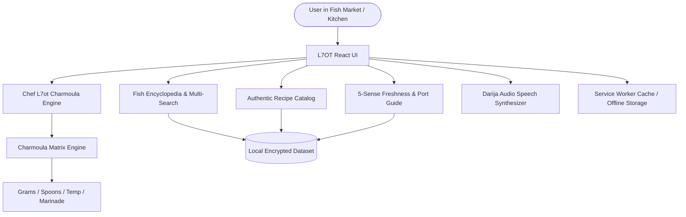

# Architecture & Engineering Design

L7OT is designed as an offline-first, client-rendered Progressive Web App (PWA) with sub-second interaction speed, zero server latency, and complete multi-lingual support.

## Component Architecture

1. **State & i18n Layer**:
   - `STRINGS` dictionary providing immediate, zero-flash locale transitions between Moroccan Arabic (Darija), French, and English.
   - RTL directionality switching dynamically based on active locale.

2. **The "Chef L7ot" Calculation Algorithm (`src/lib/charmoula.ts`)**:
   - Computes exact spice ratios as a function of:
     - Meat density & fat profile (Oily pelagic vs delicate white fish vs cephalopod vs crustacean).
     - Cooking thermodynamics (Clay tagine braising vs 200°C convection oven vs screaming hot fry oil vs charcoal embers).
     - Scalable serving multiplier (1 to 12 persons).

3. **Media & Fallback Pipeline**:
   - High-definition live photography curated from Wikimedia Commons and Unsplash.
   - Automatic fallback SVG rendering ensures no broken image icons ever show if network connectivity drops.

4. **Speech Synthesis**:
   - `speakDarija()` utilizes `window.speechSynthesis` targeting native Arabic voices (`ar-MA` or Arabic variants) with phonetic Latin fallbacks for international travelers.
